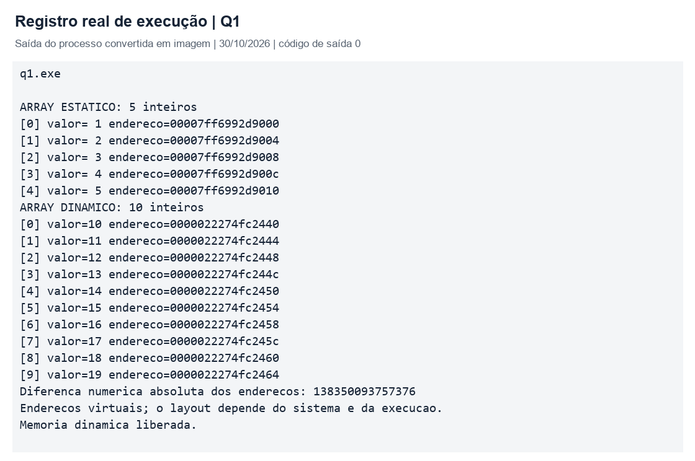
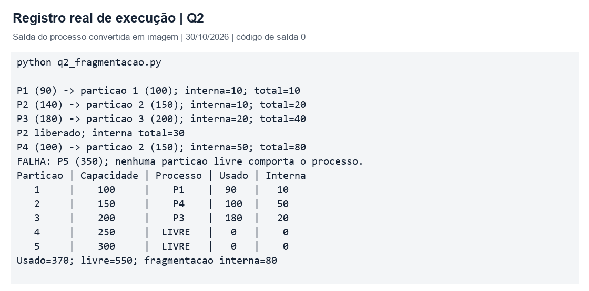
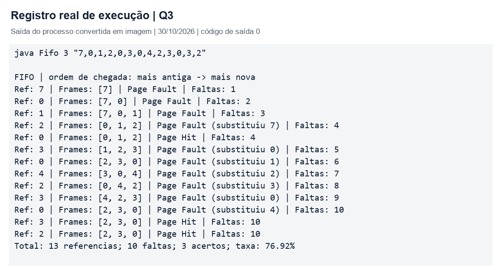
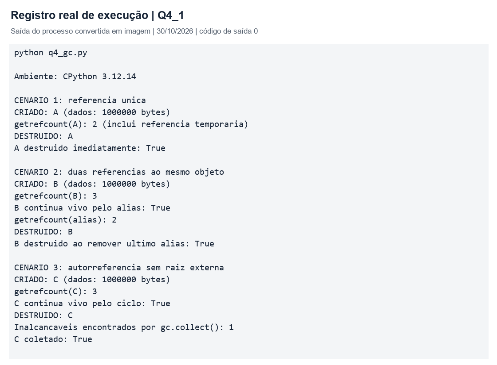
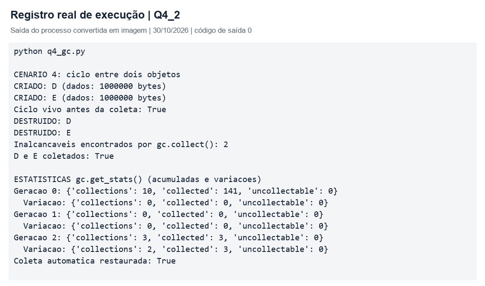
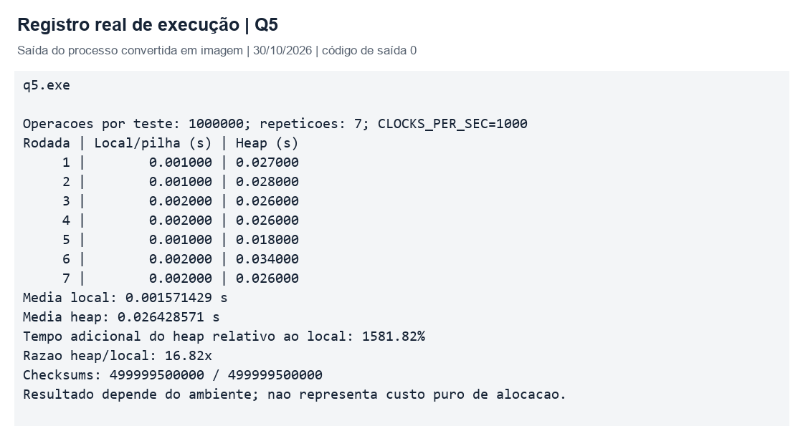
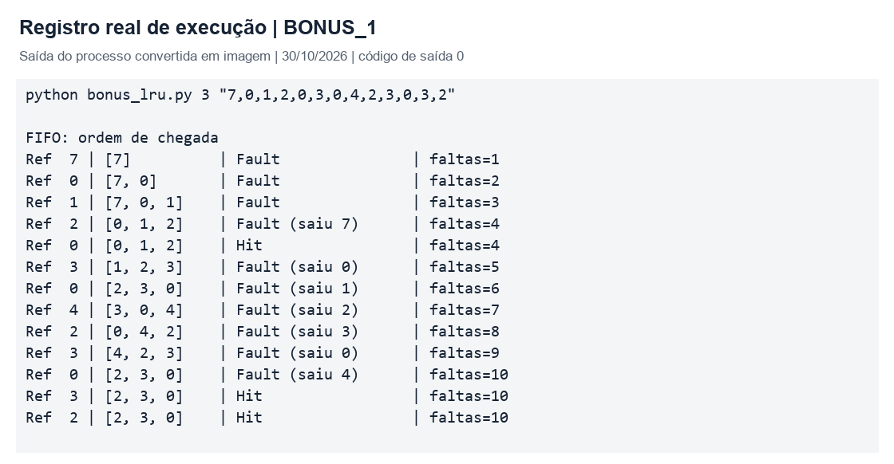
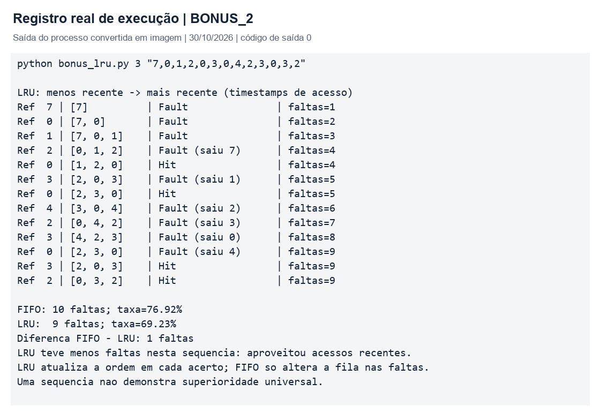

# Gerenciamento de Memória

em Sistemas Operacionais

Trabalho prático 1 do 2º bimestreProfessor: José Carlos Domingues Flores

Estudo de alocação, fragmentação, substituição de páginas, coleta de lixo e desempenho, com implementações em C, Python e Java e comparação adicional entre FIFO e LRU.

## Identificação do grupo

Campos de identificação preenchíveis no PDF. Preencher ao menos cinco integrantes antes da entrega.

Turma: ____________________
Data: ____________________
1. Nome: ____________________ | RA: __________
2. Nome: ____________________ | RA: __________
3. Nome: ____________________ | RA: __________
4. Nome: ____________________ | RA: __________
5. Nome: ____________________ | RA: __________
6. Nome: ____________________ | RA: __________
7. Nome: ____________________ | RA: __________
8. Nome: ____________________ | RA: __________
Representante: ____________________
GitHub: ____________________

# Resumo e organização

O trabalho investiga como a memória é reservada, utilizada e recuperada. Os experimentos mostram que a política escolhida influencia desperdício, faltas de página e tempo de execução. As implementações são didáticas: não alteram o gerenciador de memória do sistema operacional.

## Resultados centrais

Questão | Programa | Resultado observado
1 | q1_alocacao.c | Arrays com 5 e 10 inteiros; endereços exibidos e memória dinâmica liberada.
2 | q2_fragmentacao.py | 370 unidades utilizadas, 550 livres e 80 de fragmentação interna.
3 | Fifo.java | Com 3 quadros: 10 faltas em 13 referências (76,92%).
4 | q4_gc.py | Quatro cenários distinguem referências comuns, aliases e ciclos.
5 | q5_desempenho.c | 1.000.000 de operações por teste, com sete repetições e médias.
Bônus | bonus_lru.py | LRU: 9 faltas (69,23%); uma falta a menos que FIFO.

## Método e evidências

Os programas foram executados em Windows x64, com CPython 3.12.14, OpenJDK 25.0.4.1 e GCC 16.2.0 (w64devkit 2.11.0). Os programas C foram compilados em C11, sem otimização, com avisos habilitados. As versões e os comandos estão registrados em resultados/ambiente.json.

As imagens foram geradas diretamente das saídas reais dos processos, sem alteração dos resultados; não são capturas de tela de terminal. Os registros completos estão em resultados/*.txt e suas imagens em evidencias/*.png. As capturas de tela exigidas pelo enunciado devem ser acrescentadas à pasta capturas antes da entrega. Os códigos-fonte são entregues separadamente, na pasta codigos.

Os números de endereço, tempos e estatísticas acumuladas do coletor podem variar em outra execução. As contagens de faltas e os valores de fragmentação são determinísticos para as entradas utilizadas.

## Mapa do relatório

Questões 1 a 3: páginas 3 a 5. Questão 4: páginas 6 e 7. Questão 5: página 8. Bônus: páginas 9 e 10. Reprodução e testes: página 11. Referências: página 12.

# 1  Alocação estática e dinâmica

Na alocação estática, a reserva tem tamanho definido e duração que abrange a execução do programa. Na dinâmica, a memória é solicitada durante a execução, por exemplo com malloc, e permanece válida até a liberação com free. Um array local de tamanho fixo sem static tem duração automática, geralmente associada à pilha; tamanho fixo e duração estática são propriedades diferentes. [1, 2]

Tipo | Duas vantagens | Duas desvantagens
Estática | Capacidade previsível; dispensa malloc/free para o objeto. | Não pode crescer; a reserva permanece mesmo em períodos sem uso.
Dinâmica | Tamanho decidido em execução; duração pode ultrapassar a função criadora. | Pode falhar ou ter custo de gerenciamento; exige cuidado para evitar vazamentos e acessos após free.

O programa usa static int fixo[5] e malloc para dez inteiros, verifica NULL e imprime cada valor com seu endereço. A diferença é calculada entre representações uintptr_t: subtrair ponteiros de arrays distintos diretamente não é permitido. A diferença numérica ilustra o layout virtual desta execução; não prova distância física nem uma organização universal da memória. [1, 3]

Figura 1. Valores 1 a 5 e 10 a 19, endereços e liberação do bloco dinâmico.

# 2  Fragmentação de memória

Fragmentação interna é o espaço reservado dentro de uma unidade alocada que o processo não utiliza. Exemplo: um processo de 90 unidades em uma partição de 100 desperdiça 10. Fragmentação externa ocorre quando áreas livres separadas não atendem a uma solicitação contígua, embora a soma seja suficiente. Exemplo: lacunas de 120 e 180, separadas por memória ocupada, não atendem a um bloco de 250. [4]

A simulação mantém cinco partições indivisíveis de 100, 150, 200, 250 e 300 unidades. First-Fit percorre essa ordem e escolhe a primeira partição livre suficiente. Ao liberar P2, a partição de 150 fica disponível e recebe P4, gerando 50 unidades de desperdício.

Figura 2. Sequência exigida no enunciado e estado final da memória.

Análise: P1 desperdiça 10, P4 desperdiça 50 e P3 desperdiça 20: total de 80 unidades. A identidade 370 + 550 + 80 = 1.000 confirma a conservação da capacidade. P5 falha porque nenhuma partição comporta 350; as partições livres de 250 e 300 não podem ser fundidas neste modelo.

Essa falha é uma limitação das partições fixas. Não se deve tratar as 550 unidades livres como fragmentação interna, nem concluir que o programa simula a fragmentação externa de um alocador de blocos variáveis. As duas definições teóricas permanecem distintas.

# 3  Substituição de páginas FIFO

FIFO remove a página que entrou há mais tempo na memória quando há falta e todos os quadros estão ocupados. Um acerto não muda sua posição. Suas vantagens são simplicidade e baixo custo de manutenção; as desvantagens são ignorar o uso recente e poder apresentar a anomalia de Belady, na qual mais quadros produzem mais faltas. [5]

A implementação Java combina Queue/ArrayDeque para a ordem de chegada e HashSet para consulta de presença. A fila exibida vai da página mais antiga à mais nova; não representa posições físicas imutáveis dos quadros. Operações principais têm custo esperado/amortizado constante; imprimir todos os quadros custa O(F), sendo F o número de quadros. [6]

Figura 3. FIFO com 3 quadros e a sequência de 13 referências do enunciado.

Análise: são 10 faltas e 3 acertos. A taxa é 10/13 = 0,7692 = 76,92%. Na quinta referência, a página 0 é acessada, mas mantém a posição de mais antiga; na referência seguinte, é removida. Esse comportamento explica por que recência e ordem de entrada não são equivalentes.

O programa aceita entrada interativa ou argumentos, rejeita quadros não positivos, referências negativas, valores não inteiros e sequência vazia.

# 4  Coleta de lixo em Python

No CPython, a contagem de referências acompanha quantas referências fortes apontam para um objeto. Quando essa contagem chega a zero, ele pode ser destruído imediatamente. Remover um nome com del não destrói o objeto se ainda existe outro alias. sys.getrefcount inclui uma referência temporária da própria chamada. Esse comportamento de finalização não é uma garantia de todas as implementações de Python. [7]

Ciclos podem manter contagens positivas mesmo sem acesso a partir do programa. O coletor cíclico complementa a contagem: identifica estruturas inalcançáveis. No CPython 3.12, organiza os objetos rastreados em três gerações; sobreviventes avançam de geração e objetos mais jovens são examinados com maior frequência. gc.collect() solicita uma coleta completa. [8]

Cada Objeto possui nome, um bytearray de 1.000.000 de bytes e mensagens em __init__/__del__. A coleta automática de ciclos é temporariamente desativada para tornar a observação controlável; a contagem de referências continua ativa. Referências fracas permitem observar os objetos sem prolongar sua vida.

Figura 4. Referência única, dois aliases e autorreferência; resultados reais do CPython.

# 4  Ciclos e estatísticas do coletor

Figura 5. Ciclo entre dois objetos e estatísticas acumuladas e incrementais.

## Interpretação dos quatro cenários

1. A é destruído após del a, pois não resta referência forte. 2. B permanece vivo depois de del b porque alias ainda o referencia; a destruição ocorre após remover o alias. 3. C referencia a si mesmo e permanece vivo até gc.collect(). 4. D e E referenciam um ao outro e são recuperados pela coleta explícita.

As contagens observadas de getrefcount foram 2 para A, 3 para B com alias e 3 para C com autorreferência; elas incluem a referência temporária. Os testes com weakref confirmam o desaparecimento dos objetos sem manter uma referência forte adicional.

gc.get_stats informa collections, collected e uncollectable por geração. A comparação antes/depois separa o experimento das coletas ocorridas na inicialização. Nesta execução, as duas coletas explícitas recuperaram os três objetos cíclicos C, D e E; nenhuma ocorrência nova ficou não coletável. Esses números contam objetos rastreados, não bytes liberados. [8]

A memória recuperada pelo interpretador não precisa ser imediatamente devolvida ao sistema operacional. A implementação restaura em finally o estado anterior da coleta automática.

# 5  Desempenho de alocação

A pilha organiza quadros de chamadas em ordem de entrada e saída; reservar espaço local normalmente exige ajustes simples no ponteiro de pilha. O heap permite durações independentes e tamanhos variáveis; o alocador precisa administrar blocos disponíveis e metadados. Por isso, a reserva local costuma ser mais barata, mas compiladores também podem manter variáveis em registradores ou eliminar operações. [2, 3]

O teste C cria uma variável local por chamada e, no outro caminho, executa malloc/free de um inteiro. Cada medição repete 1.000.000 de chamadas, com sete rodadas, aquecimento separado e ordem alternada. A compilação sem otimização, noinline e acessos volatile ajudam a preservar as operações. Checksums verificam os valores produzidos.

Figura 6. Tempos medidos; sete rodadas por modalidade, sem o aquecimento na média.

Resultado: média local de 0.001571 s e média no heap de 0.026429 s. O tempo adicional do heap, relativo ao local, foi de 1581.82%, calculado por 100 × (T_heap - T_local) / T_local. Esse percentual descreve aumento de tempo; não é uma porcentagem de “velocidade a menos”.

A resolução observada foi de 1 ms, enquanto as rodadas locais duraram apenas 1 ou 2 ms. Portanto, a razão e o percentual têm elevada incerteza de quantização e devem ser interpretados como ilustração, não como estimativa precisa de desempenho. A média de várias rodadas não elimina essa limitação.

O ensaio inclui chamada, acesso, retorno, soma e laço; não isola o custo puro de alocação. O heap reutiliza blocos: não há um milhão de objetos simultâneos. Resolução de clock(), carga do computador, cache e compilador influenciam os tempos. Na biblioteca C do Windows, clock mede tempo decorrido; a semântica pode diferir em outros ambientes. [9]

# Bônus  Algoritmo LRU

LRU substitui a página cujo último uso é o mais antigo. A implementação usa OrderedDict: cada chave é uma página e cada valor, o instante lógico da última referência. Em acertos, atualiza o instante e move a chave para o fim; quando necessário, remove a primeira chave. Assim, mantém explicitamente a ordem de recência sem ordenar todas as páginas a cada acesso. [10]

O mesmo programa executa FIFO e LRU com os mesmos quadros e referências. A implementação FIFO adicional foi confrontada com o programa Java da questão 3, inclusive em dez sequências aleatórias reproduzíveis.

Figura 7. FIFO usado como referência de comparação no programa do bônus.

Busca, atualização e remoção são O(1) em média; a memória auxiliar é O(F). A impressão do estado custa O(F) por referência. O armazenamento de timestamps documenta o último uso, enquanto a ordem mantida pelo dicionário permite escolher a vítima diretamente.

# Bônus  Comparação e análise crítica

Figura 8. LRU com a mesma entrada e comparação final.

Política | Referências | Faltas | Acertos | Taxa
FIFO | 13 | 10 | 3 | 76,92%
LRU | 13 | 9 | 4 | 69,23%

LRU evitou uma falta: redução de 10% no número de faltas, ou 7,69 pontos percentuais na taxa. Ao acessar 0 na quinta referência, LRU registra o uso recente; na chegada de 3, remove 1 e preserva 0, que é usado novamente. FIFO remove 0 e sofre uma falta adicional.

LRU explora a localidade temporal, mas precisa atualizar o histórico nos acertos. FIFO mantém uma regra mais simples. Esta sequência favorece LRU, sem demonstrar superioridade em toda carga. LRU exato não apresenta a anomalia de Belady, mas implementá-lo para todas as referências reais de memória pode ter custo elevado. [5]

# Reprodução e validação

Pré-requisitos: compilador C11 (GCC, Clang ou Zig cc), CPython 3.10 ou posterior e JDK 11 ou posterior. O comportamento de gerações descrito foi validado especificamente em CPython 3.12. Execute os comandos abaixo dentro de codigos. Em Linux/macOS, use ./q1 e ./q5; no Windows, .\q1.exe e .\q5.exe.

Etapa | Comando
Q1 - C | gcc -std=c11 -O0 -Wall -Wextra -pedantic q1_alocacao.c -o q1
Q2 - Python | python q2_fragmentacao.py
Q3 - Java | javac -encoding UTF-8 Fifo.java java Fifo 3 "7,0,1,2,0,3,0,4,2,3,0,3,2"
Q4 - Python | python q4_gc.py
Q5 - C | gcc -std=c11 -O0 -Wall -Wextra -pedantic q5_desempenho.c -o q5
Bônus | python bonus_lru.py 3 "7,0,1,2,0,3,0,4,2,3,0,3,2"
Testes | python testes.py --java

O compilador utilizado foi GCC 16.2.0, distribuído no w64devkit 2.11.0 para Windows x64. Não é necessário instalar bibliotecas Python externas para os programas. O README detalha execução, organização do pacote e entrega.

## Verificações executadas

A suíte possui 11 testes aprovados: sequência de partições, limites e reutilização, entradas inválidas, conservação da capacidade em 200 operações aleatórias, exemplo FIFO/LRU, Belady, limites de quadros, erros de referências, LRU contra um oráculo independente em 100 sequências, equivalência Python/Java e erros de entrada em Java.

No caso de Belady, a sequência 1,2,3,4,1,2,5,1,2,3,4,5 produz 9 faltas com três quadros e 10 com quatro no FIFO. Os programas C compilaram sem avisos nas opções informadas; os dois checksums do benchmark foram 499999500000. As mensagens e referências fracas verificam os quatro cenários do coletor.

Os testes não provocam esgotamento real de memória: a verificação de NULL existe nos dois programas C, mas esse ramo não foi forçado. Os registros dos testes ficam em resultados/testes.txt.

# Referências

[1] ISO/IEC JTC1/SC22/WG14. N1570: Committee Draft, C11. 2011. Seções 6.2.4, 6.5.6, 7.20.1.4 e 7.22.3.https://www.open-std.org/jtc1/sc22/wg14/www/docs/n1570.pdf

[2] ARPACI-DUSSEAU, Remzi H.; ARPACI-DUSSEAU, Andrea C. Operating Systems: Three Easy Pieces. Cap. 14: Interlude: Memory API.https://pages.cs.wisc.edu/~remzi/OSTEP/vm-api.pdf

[3] ARPACI-DUSSEAU, Remzi H.; ARPACI-DUSSEAU, Andrea C. OSTEP. Cap. 13: The Abstraction: Address Spaces.https://pages.cs.wisc.edu/~remzi/OSTEP/vm-intro.pdf

[4] ARPACI-DUSSEAU, Remzi H.; ARPACI-DUSSEAU, Andrea C. OSTEP. Cap. 17: Free-Space Management.https://pages.cs.wisc.edu/~remzi/OSTEP/vm-freespace.pdf

[5] ARPACI-DUSSEAU, Remzi H.; ARPACI-DUSSEAU, Andrea C. OSTEP. Cap. 22: Beyond Physical Memory: Policies.https://pages.cs.wisc.edu/~remzi/OSTEP/vm-beyondphys-policy.pdf

[6] ORACLE. Java SE 25 API: ArrayDeque.https://docs.oracle.com/en/java/javase/25/docs/api/java.base/java/util/ArrayDeque.html

[7] PYTHON SOFTWARE FOUNDATION. Python 3.12: sys.getrefcount.https://docs.python.org/3.12/library/sys.html#sys.getrefcount

[8] PYTHON SOFTWARE FOUNDATION. Python 3.12: gc - Garbage Collector interface.https://docs.python.org/3.12/library/gc.html

[9] MICROSOFT. C runtime library reference: clock.https://learn.microsoft.com/en-us/cpp/c-runtime-library/reference/clock?view=msvc-170

[10] PYTHON SOFTWARE FOUNDATION. Python 3.12: collections.OrderedDict.https://docs.python.org/3.12/library/collections.html#collections.OrderedDict

Fontes on-line consultadas em 30 de outubro de 2026. Material de orientação: FLORES, José Carlos Domingues. Gerenciamento de Memória em Sistemas Operacionais. Enunciado disponibilizado em DocTrabFlores.pdf, 8 páginas, sem data de publicação indicada.
